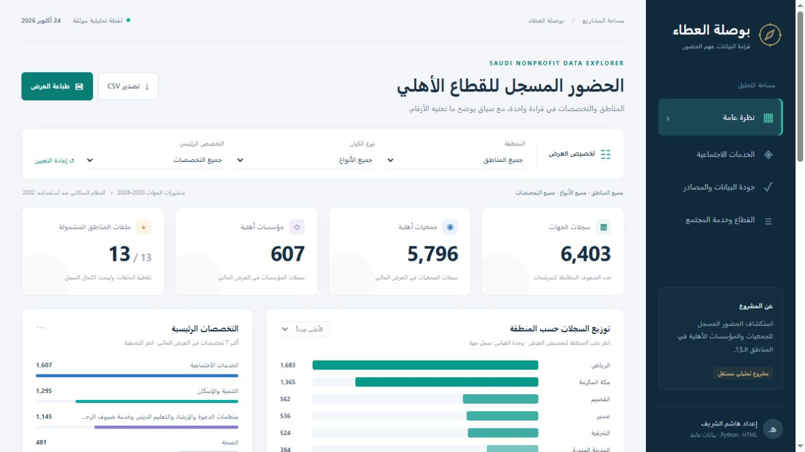

# Bouslat Al-Ataa | بوصلة العطاء

An Arabic, reproducible explorer of recorded nonprofit associations and foundations across Saudi Arabia's 13 regional publications. Python prepares the analysis; an offline HTML/CSS/JavaScript dashboard presents the results.

[العربية](README.ar.md) · [Dashboard](docs/index.html) · [Article](docs/article.ar.md) · [Article PDF](docs/article.pdf) · [Learning guide](docs/local-analysis-guide.pdf)



## Scope

- 6,403 source entity records: 5,796 association records and 607 foundation records.
- 6,341 unique published national identifiers; 62 Jouf records have no published national-ID field.
- Social services: 1,546 association records, with 61 foundation records shown separately.
- Regional population denominator: all residents in 2022, totaling 32,175,224. This is the latest complete regional year in the checked population cube, not a claim about every official source.
- Entity publications have different 2025–2026 reference periods. Counts are descriptive source records, not a simultaneous nationwide census, service coverage, unmet need, or impact.
- Nonprofit companies are discussed in the article, but are not counted in these datasets.

## View the dashboard

Open `docs/index.html` in a browser. It works offline with local assets, including filtering and CSV export. Alternatively, from the repository root:

```powershell
py -m http.server 8000 --bind 127.0.0.1 --directory docs
```

Open `http://127.0.0.1:8000`. Press Ctrl+C to stop the local preview. No hosted deployment is required.

## Reproduce the analysis

Use Python 3.12 or newer with the pinned project requirements. Commands below target Windows PowerShell:

```powershell
py -m venv .venv
.\.venv\Scripts\python.exe -m pip install -r requirements.txt
.\.venv\Scripts\python.exe scripts/run_local_reports.py
.\.venv\Scripts\python.exe scripts/verify_national_delivery.py
.\.venv\Scripts\python.exe scripts/verify_social_services.py
.\.venv\Scripts\python.exe scripts/build_showcase.py
```

The analysis uses local source files. Rebuilding the display writes `outputs/showcase`. To refresh the committed static dashboard after reviewing the new outputs:

```powershell
Copy-Item .\outputs\showcase\* .\docs\ -Recurse -Force
```

## Structure

`data_raw` preserves original selected source bytes; `config` contains explicit mapping decisions; `research` records URLs, dates, licenses and hashes; `data_clean` contains derived tables; `scripts` holds reproducible steps; `outputs/national` contains tables, charts and checks; `presentation` contains dashboard source assets; `docs` holds the prepared static presentation and article.

## Data attribution and rights

Entity source: National Center for Non-Profit Sector regional publications on the Saudi Open Data portal. Population source: General Authority for Statistics via DataSaudi. Full source links, dates and hashes are in `research/national_sources.json` and `research/population_sources.json`. See [DATA_LICENSE.md](DATA_LICENSE.md) and the included source license. Data rights are separate from software rights. Derived calculations and mapping decisions are the project's work; attribution does not imply publisher endorsement.

## Design and interpretation

The dashboard has overview, social-services, data-quality and article views. Population comparison fixes the numerator to social-service association records. Missing identifiers stay missing. Makkah's first subcategory is excluded from that subcategory comparison because the source repeats both subcategory levels. A review flag does not automatically invalidate every field in a record.

Prepared by Hashim Alsharif with AI assistance documented in `ai_usage_log.md`. This is an independent descriptive analytics project.
